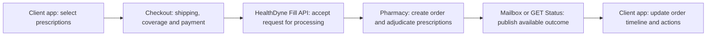
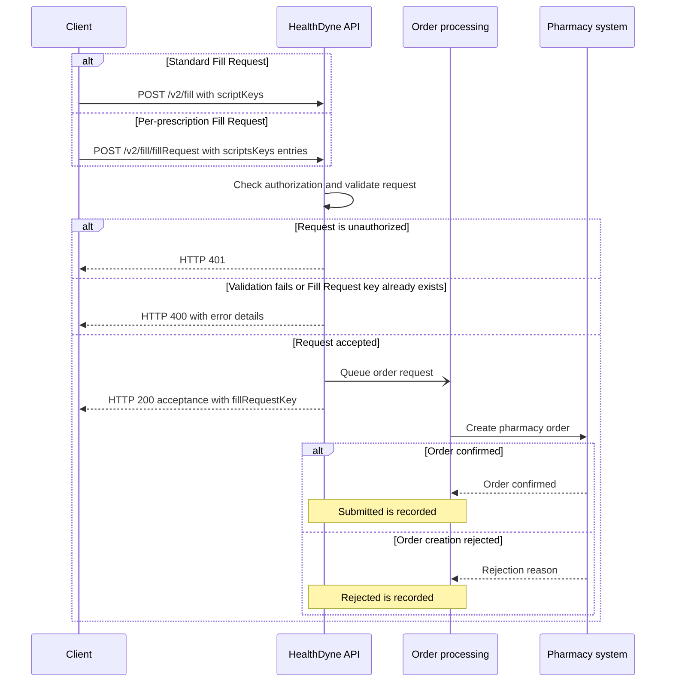
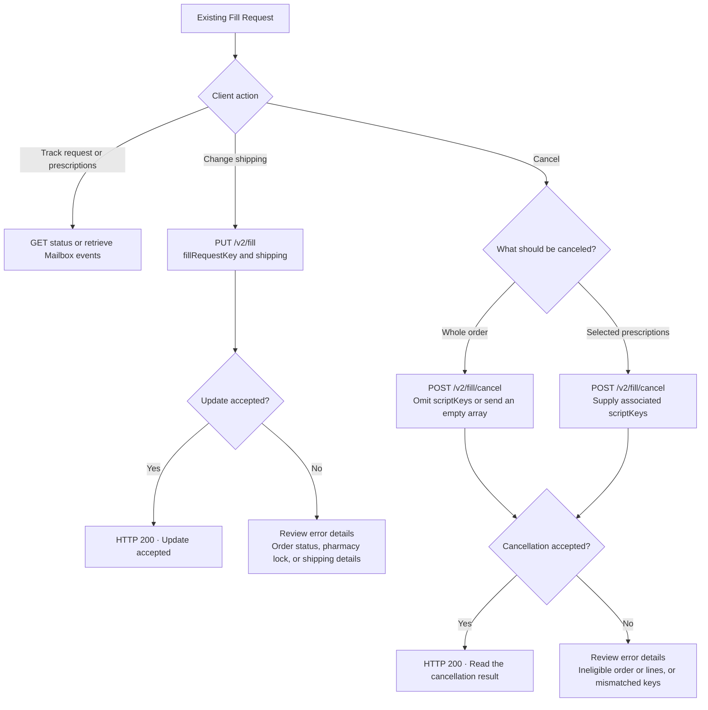
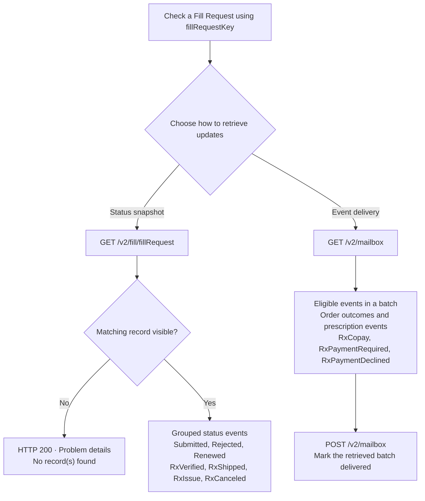

# Fill Request:

See [Fill](ref:post_v2-fill) API reference for request message fields.

This API lets client define when the order needs to be initiated in HealthDyne system and also defines the number of prescriptions/scripts that need to be consolidated in one order. A client can also use the GET method of Fill Request to retrieve current status.

## How a fill moves from checkout to shipment

Use Fill Request after you have selected prescriptions eligible for filling for the same patient. The client app collects shipping details and any applicable insurance or payment choices. HealthDyne accepts the request for processing and the pharmacy determines the order outcome.



| What the user needs to do | What the app should do |
| :--- | :--- |
| Choose one insurance plan for the order | Use the standard submit route with optional order-level insurance. |
| Choose coverage for individual prescriptions | Use the per-prescription route. For each prescription, send an existing plan or supported inline insurance details. PCN is optional for detailed inline insurance on this route. |
| Include an eligible OTC item | Use the per-prescription route. Send the mapped product ID and a positive whole-number quantity with at least one prescription. |
| Choose a saved card | Use the saved card sequence number for that patient and check Mailbox for the payment outcome. |
| Check whether the pharmacy created the order | After HTTP 200, show **Received for processing**. Keep the Fill Request key and check for `Submitted` or `Rejected` before showing the outcome. |
| Review payment or prescription issues | Track events for each prescription separately. Use Mailbox to display the relevant copay, payment action, or prescription issue when available. |
| Change shipping or cancel | Use the existing Fill Request key. Request an eligible shipping update or cancel the whole order or selected prescriptions. If the pharmacy denies the change, show the reason and refresh the status. |

[Interactive API scenarios](#interactive-fill-request-scenarios) · [Patient](doc:patient-request) · [Insurance](doc:insurance) · [Payment Cards](doc:payment-card-apis) · [Mailbox](doc:mail-box)

# Get Fill Request Status

The GET Fill Request Status API lets clients retrieve the status and event summary for previously submitted Fill Requests.

Use the client-assigned `fillRequestKey` for the lookup. The response groups events by type. Match prescription events using `scriptKey` and use the event timestamps to reconstruct the history. The `renewed` array contains recorded renewal events when available. [GET API reference](ref:get_v2-fill-fillrequest)

#### Server

##### Only HTTPS connections are accepted.

| METHOD TYPE | ENDPOINT                                                                    |
| :---------- | :-------------------------------------------------------------------------- |
| GET (Test)  | api.uat-healthdyne.com/v2/FILL/fillRequest?fillRequestKey=\<fillRequestKey> |
| GET (Prod)  | api.healthdyne.com/v2/FILL/fillRequest?fillRequestKey=\<fillRequestKey>     |

#### Header

| Key                         | Value                  |
| :-------------------------- | :--------------------- |
| Accept                      | application/json       |
| Content-Type                | application/json       |
| HealthDyne-Subscription-Key | Provided by HealthDyne |
| HealthDyne-Relationship-Key | Provided by HealthDyne for authorized vendor requests |

#### Sample GET Status Request

`GET https://api.uat-healthdyne.com/v2/fill/fillRequest?fillRequestKey=FillPatientSample1404`

Click here to see [GET Fill Request Query Data](doc:fill-request-fields#query-parameter)

#### GET Status Response Samples

> 📘 NOTE: Sample for a Single-line Rx.

```json
{
    "fillRequestKey": "ccdd5fd46a714cc09bc679f0365b2",
    "submitted": [
        {
            "eventId": "295955",
            "eventDateUtc": "2025-04-15T09:12:20.913021+00:00",
            "scriptKeys": [
                "SampleScriptKey007"
            ]
        }
    ],
    "rxVerified": [
        {
            "eventId": "295965",
            "eventDateUtc": "2025-04-15T09:16:48.804578+00:00",
            "scriptKey": "24388f1b53c04b0a89534056c311ece6326",
            "verifiedDate": "2025-04-15T09:16:48.804578+00:00",
            "statusMessage": "The Rx has been verified by the pharmacist (PV1)"
        }
    ],
    "rxShipped": [
        {
            "eventId": "295985",
            "eventDateUtc": "2025-04-17T09:19:53.417176+00:00",
            "scriptKey": "24388f1b53c04b0a89534056c311ece6326",
            "shipmentDate": "2025-04-17T06:00:02Z",
            "trackingNumber": "7548253"
        }
    ],
    "rxIssue": [],
    "rxCanceled": [],
    "rejected": [],
    "renewed": []
}
```

> 📘 NOTE: Sample for a Multiline Rx.

```json
{
    "fillRequestKey": "FillPatientSample1404",
    "submitted": [
        {
            "eventId": "295955",
            "eventDateUtc": "2025-04-15T09:12:20.913021+00:00",
            "scriptKeys": [
                "SampleScriptKey1",
                "SampleScriptKey2"
            ]
        }
    ],
    "rxVerified": [
        {
            "eventId": "288774",
            "eventDateUtc": "2025-04-11T18:43:07.995451Z",
            "scriptKey": "TestScriptKey1401",
            "verifiedDate": "2025-04-15T09:16:48.804578+00:00",
            "statusMessage": "The Rx has been verified by the pharmacist (PV1)"
        },
        {
            "eventId": "2887749",
            "eventDateUtc": "2025-04-11T18:453:07.995451Z",
            "scriptKey": "TestScriptKey14091",
            "verifiedDate": "2025-04-15T09:16:48.804578+00:00",
            "statusMessage": "The Rx has been verified by the pharmacist (PV1)"
        }
    ],
    "rxShipped": [],
    "rxIssue": [
        {
            "eventId": "289773",
            "eventDateUtc": "2025-04-15T09:30:57.585214+00:00",
            "scriptKey": "TestScriptKey1401",
            "issueMessage": "REJECTED 533 HEALTHDYNE RX REJECTED - "
        }
    ],
    "rxCanceled": [
        {
            "eventId": "288784",
            "eventDateUtc": "2025-04-11T18:50:00.418881Z",
            "scriptKey": "TestScriptKey1401",
            "statusMessage": "Cancelled"
        },
        {
            "eventId": "2887864",
            "eventDateUtc": "2025-04-11T18:50:00.418881Z",
            "scriptKey": "TestScriptKey14091",
            "statusMessage": "Cancelled"
        }
    ],
    "rejected": [
        {
            "eventId": "156270",
            "eventDateUtc": "2025-02-18T13:36:57.776842Z",
            "scriptKeys": [],
            "statusMessage": "RX: 10524420 found on OPEN order with External ID: NULL; "
        }
    ],
    "renewed": []
}
```

Click here to see [Get Fill Request Data Object](doc:fill-request-fields#response-object)

The table below lists the potential response codes that can be received in response to a GET request.

| Code | Description                                              |
| :--- | :------------------------------------------------------- |
| 200  | Fill Request status or a problem details response with `detail` set to `No record(s) found` |
| 400  | Missing or invalid request parameter        |
| 401  | Unauthorized                                             |
| 500  | Internal Server Error                                    |

***

# Submit Fill Request

API field validation information in Appendix [Fill Request Fields](doc:fill-request-fields#fill-request-data-object).

Client must send a Fill request with following details:

1. `fillRequestKey`: Unique key used to track each Fill Request. Maximum 50 characters.
2. For the standard request, `scriptKeys`: an array of `scriptKey` values for the same patient. For the per-prescription request, use `scriptsKeys` entries with a `scriptsKey` in each.

Transferred prescriptions must be in `Transferred` status. Eligible prescriptions from HealthDyne intake can be in `Received` status. Discontinued prescriptions, prescriptions with no fills available, and keys outside the authorized client scope can fail validation. Replace sample values with valid values for the target environment.


#### v2.32 API Walkthrough

The diagrams and interactive scenarios below show the documented v2.32 API flows.

#### Fill Request Sequence

Both submit routes queue pharmacy order creation after validation. Use the original Fill Request key to check the outcome if a submission response is uncertain.



#### Fill Request API Flow

Use the existing Fill Request key to check status, change shipping, or request cancellation.



#### Fill Request Status and Mailbox Flow

Use GET status for grouped history and Mailbox for batch delivery, including copay and payment events. Prescription events can occur at different times for individual lines. Order splitting can affect which lines are canceled. [Fill Request status events](doc:mail-box#fill-request-status-events) · [Response codes](#get-fill-request-status)



#### Interactive Fill Request Scenarios

Expand a scenario to see the API call, response, and next step.

##### Submit

<Accordion title="Standard request accepted">
  Send `scriptKeys` for one patient. Standard requests can include order-level insurance.

  **Server**

  Only HTTPS connections are accepted.

  | **METHOD TYPE** | **ENDPOINT** |
  | :--- | :--- |
  | POST (Test) | api.uat-healthdyne.com/v2/fill |
  | POST (Prod) | api.healthdyne.com/v2/fill |

  **Sample Submit Fill Request**

  `POST https://api.uat-healthdyne.com/v2/fill`

  **Sample Submit Fill Request Body**

  ```json
  {
    "fillRequestKey": "FILL-EXAMPLE-1001",
    "scriptKeys": [
      "SCRIPT-EXAMPLE-001",
      "SCRIPT-EXAMPLE-002"
    ],
    "shipping": {
      "address": {
        "line1": "100 Example Street",
        "city": "LAKELAND",
        "state": "FL",
        "zipCode": "33810",
        "countryCode": "US"
      },
      "shippingCode": "POS 1M",
      "saturdayDelivery": false,
      "signatureRequired": false
    }
  }
  ```

  Click here to see [Standard Fill Request Data Object](doc:fill-request-fields#request-object)

  **Sample Submit Fill Response**

  **HTTP 200**

  ```json
  {
    "fillRequestKey": "FILL-EXAMPLE-1001",
    "message": "The fill request was accepted"
  }
  ```

  Click here to see [Standard Submit Response Data Object](doc:fill-request-fields#response-object-1)

  Save the `fillRequestKey`. Check GET status or Mailbox for `Submitted` or `Rejected` after the pharmacy processes the request.

  [Standard POST API reference](ref:post_v2-fill)
</Accordion>

<Accordion title="Per-prescription request accepted">
  Send `scriptsKeys` entries with a `scriptsKey` for each prescription. Options include `patientInsurance`, a saved payment card sequence, and eligible OTC items. PCN is optional for inline insurance on this route.

  **Server**

  Only HTTPS connections are accepted.

  | **METHOD TYPE** | **ENDPOINT** |
  | :--- | :--- |
  | POST (Test) | api.uat-healthdyne.com/v2/fill/fillRequest |
  | POST (Prod) | api.healthdyne.com/v2/fill/fillRequest |

  **Sample Submit Fill Request**

  `POST https://api.uat-healthdyne.com/v2/fill/fillRequest`

  **Sample Submit Fill Request Body**

  ```json
  {
    "fillRequestKey": "FILL-EXAMPLE-1002",
    "paymentCardSequenceNumber": "12345",
    "scriptsKeys": [
      {
        "scriptsKey": "SCRIPT-EXAMPLE-003",
        "patientInsurance": {
          "primaryInsurance": {
            "bin": "123456",
            "groupNumber": "EXAMPLEGRP",
            "memberId": "EXAMPLE001",
            "relationship": "1"
          },
          "secondaryPlanNumber": "502",
          "clientItemCost": 12.5,
          "clientDispenseFee": 2.25,
          "clientOtherFee": 0,
          "clientCoPay": 4
        }
      },
      {
        "scriptsKey": "SCRIPT-EXAMPLE-004",
        "patientInsurance": {
          "planNumber": "501",
          "clientItemCost": 13.5,
          "clientDispenseFee": 2.25,
          "clientOtherFee": 0,
          "clientCoPay": 5
        }
      }
    ],
    "shipping": {
      "address": {
        "line1": "100 Example Street",
        "city": "LAKELAND",
        "state": "FL",
        "zipCode": "33810",
        "countryCode": "US"
      },
      "shippingCode": "POS 1M",
      "saturdayDelivery": false,
      "signatureRequired": false
    },
    "transactionNumber": "TXN-EXAMPLE-1002",
    "otcItems": [
      {
        "productId": "00000000001",
        "quantity": 2
      }
    ]
  }
  ```

  Click here to see [Per-prescription Fill Request Data Object](doc:fill-request-fields#request-object-1)

  **Sample Submit Fill Response**

  **HTTP 200**

  ```json
  {
    "fillRequestKey": "FILL-EXAMPLE-1002",
    "message": "The fill request was accepted"
  }
  ```

  Click here to see [Per-prescription Submit Response Data Object](doc:fill-request-fields#response-object-2)

  Save the `fillRequestKey` and check GET status or Mailbox for the order outcome.

  [Per-prescription POST API reference](ref:post_v2-fill-fillrequest)
</Accordion>

<Accordion title="Validation error or duplicate key">
  The API validates request fields, prescription eligibility, and any insurance or OTC items supplied. The examples below show two HTTP 400 responses.

  **Server**

  Only HTTPS connections are accepted.

  | **METHOD TYPE** | **ENDPOINT** |
  | :--- | :--- |
  | POST (Test) | api.uat-healthdyne.com/v2/fill |
  | POST (Prod) | api.healthdyne.com/v2/fill |
  | POST (Test) | api.uat-healthdyne.com/v2/fill/fillRequest |
  | POST (Prod) | api.healthdyne.com/v2/fill/fillRequest |

  **Sample Submit Fill Request**

  `POST https://api.uat-healthdyne.com/v2/fill`

  **Sample Submit Fill Request Body**

  ```json
  {
    "fillRequestKey": "FILL-EXAMPLE-1001",
    "scriptKeys": [
      "SCRIPT-EXAMPLE-001",
      "SCRIPT-EXAMPLE-002"
    ],
    "shipping": {
      "address": {
        "line1": "100 Example Street",
        "city": "LAKELAND",
        "state": "FL",
        "zipCode": "33810",
        "countryCode": "US"
      },
      "shippingCode": "POS 1M",
      "saturdayDelivery": false,
      "signatureRequired": false
    }
  }
  ```

  **Sample Per-prescription Submit Fill Request**

  `POST https://api.uat-healthdyne.com/v2/fill/fillRequest`

  **Sample Per-prescription Submit Fill Request Body**

  ```json
  {
    "fillRequestKey": "FILL-EXAMPLE-1002",
    "paymentCardSequenceNumber": "12345",
    "scriptsKeys": [
      {
        "scriptsKey": "SCRIPT-EXAMPLE-003",
        "patientInsurance": {
          "primaryInsurance": {
            "bin": "123456",
            "groupNumber": "EXAMPLEGRP",
            "memberId": "EXAMPLE001",
            "relationship": "1"
          },
          "secondaryPlanNumber": "502",
          "clientItemCost": 12.5,
          "clientDispenseFee": 2.25,
          "clientOtherFee": 0,
          "clientCoPay": 4
        }
      },
      {
        "scriptsKey": "SCRIPT-EXAMPLE-004",
        "patientInsurance": {
          "planNumber": "501",
          "clientItemCost": 13.5,
          "clientDispenseFee": 2.25,
          "clientOtherFee": 0,
          "clientCoPay": 5
        }
      }
    ],
    "shipping": {
      "address": {
        "line1": "100 Example Street",
        "city": "LAKELAND",
        "state": "FL",
        "zipCode": "33810",
        "countryCode": "US"
      },
      "shippingCode": "POS 1M",
      "saturdayDelivery": false,
      "signatureRequired": false
    },
    "transactionNumber": "TXN-EXAMPLE-1002",
    "otcItems": [
      {
        "productId": "00000000001",
        "quantity": 0
      }
    ]
  }
  ```

  Click here to see [Standard Fill Request Data Object](doc:fill-request-fields#request-object) · [Per-prescription Fill Request Data Object](doc:fill-request-fields#request-object-1)

  **Sample Submit Fill Responses**

  **HTTP 400** · Standard request with a duplicate key.

  ```json
  {
    "fillRequestKey": "FILL-EXAMPLE-1001",
    "message": "The request already exists"
  }
  ```

  **HTTP 400** · Per-prescription request with an invalid OTC quantity.

  ```json
  {
    "fillRequestKey": "FILL-EXAMPLE-1002",
    "message": "The request failed validation",
    "validationErrors": [
      "OTC quantity must be greater than 0."
    ]
  }
  ```

  Click here to see [Standard Submit Response Data Object](doc:fill-request-fields#response-object-1) · [Per-prescription Submit Response Data Object](doc:fill-request-fields#response-object-2)

  Correct invalid fields before retrying. If the key already exists or the original response is uncertain, look up the existing key before submitting another request.

  [Standard POST API reference](ref:post_v2-fill) · [Per-prescription POST API reference](ref:post_v2-fill-fillrequest)
</Accordion>

<Accordion title="Unauthorized request">
  This example uses GET status. Use a valid `HealthDyne-Subscription-Key` for the relevant client and a `HealthDyne-Relationship-Key` when authorized to act as a vendor.

  **Server**

  Only HTTPS connections are accepted.

  | **METHOD TYPE** | **ENDPOINT** |
  | :--- | :--- |
  | GET (Test) | api.uat-healthdyne.com/v2/fill/fillRequest |
  | GET (Prod) | api.healthdyne.com/v2/fill/fillRequest |

  **Sample GET Status Request**

  `GET https://api.uat-healthdyne.com/v2/fill/fillRequest?fillRequestKey=FillPatientSample1404`

  Click here to see [GET Fill Request Query Data](doc:fill-request-fields#query-parameter)

  **Sample GET Status Response**

  **HTTP 401** · Unauthorized. The example uses missing or invalid credentials.

  Click here to see [Get Fill Request Data Object](doc:fill-request-fields#response-object)

  Check the credentials, environment, and permissions for the selected operation. See [Fill Request headers](#header).

  [GET Status API reference](ref:get_v2-fill-fillrequest)
</Accordion>

<Accordion title="Pharmacy rejects order">
  A valid submit can return HTTP 200 before the pharmacy attempts to create the order. The resulting rejection appears in GET status or as a Mailbox event.

  **Server**

  Only HTTPS connections are accepted.

  | **METHOD TYPE** | **ENDPOINT** |
  | :--- | :--- |
  | GET (Test) | api.uat-healthdyne.com/v2/fill/fillRequest |
  | GET (Prod) | api.healthdyne.com/v2/fill/fillRequest |
  | GET (Test) | api.uat-healthdyne.com/v2/mailbox |
  | GET (Prod) | api.healthdyne.com/v2/mailbox |

  **Sample GET Status Request**

  `GET https://api.uat-healthdyne.com/v2/fill/fillRequest?fillRequestKey=FillPatientSample1404`

  **Sample Mailbox Request**

  `GET https://api.uat-healthdyne.com/v2/mailbox`

  Click here to see [GET Fill Request Query Data](doc:fill-request-fields#query-parameter) · [Mailbox Data Object](doc:mailbox-data-object-schemas)

  **Sample GET Status Response**

  **HTTP 200** · GET status reports the downstream rejection.

  ```json
  {
    "fillRequestKey": "FillPatientSample1404",
    "submitted": [],
    "rxVerified": [],
    "rxShipped": [],
    "rxIssue": [],
    "rxCanceled": [],
    "rejected": [
      {
        "eventId": "156270",
        "eventDateUtc": "2025-02-18T13:36:57.776842Z",
        "scriptKeys": [],
        "statusMessage": "RX: 10524420 found on OPEN order with External ID: NULL; "
      }
    ],
    "renewed": []
  }
  ```

  Click here to see [Get Fill Request Data Object](doc:fill-request-fields#response-object)

  Read the rejection reason before resubmitting. See the [Mailbox Rejected event](doc:mail-box#rejected).

  [GET Status API reference](ref:get_v2-fill-fillrequest) · [Mailbox API guide](doc:mail-box)
</Accordion>

##### Track

<Accordion title="Status lookup finds no record">
  Use the client-assigned `fillRequestKey` in the query. This example looks up a key with no matching record.

  **Server**

  Only HTTPS connections are accepted.

  | **METHOD TYPE** | **ENDPOINT** |
  | :--- | :--- |
  | GET (Test) | api.uat-healthdyne.com/v2/fill/fillRequest |
  | GET (Prod) | api.healthdyne.com/v2/fill/fillRequest |

  **Sample GET Status Request**

  `GET https://api.uat-healthdyne.com/v2/fill/fillRequest?fillRequestKey=FILL-EXAMPLE-NOT-FOUND`

  Click here to see [GET Fill Request Query Data](doc:fill-request-fields#query-parameter)

  **Sample GET Status Response**

  **HTTP 200** · Problem Details excerpt.

  ```json
  {
    "status": 200,
    "detail": "No record(s) found"
  }
  ```

  Click here to see [Get Fill Request Data Object](doc:fill-request-fields#response-object)

  Check the key, environment, and client scope.

  [GET Status API reference](ref:get_v2-fill-fillrequest)
</Accordion>

<Accordion title="Status lookup fails">
  This request omits the required `fillRequestKey` query parameter.

  **Server**

  Only HTTPS connections are accepted.

  | **METHOD TYPE** | **ENDPOINT** |
  | :--- | :--- |
  | GET (Test) | api.uat-healthdyne.com/v2/fill/fillRequest |
  | GET (Prod) | api.healthdyne.com/v2/fill/fillRequest |

  **Sample GET Status Request**

  `GET https://api.uat-healthdyne.com/v2/fill/fillRequest`

  Click here to see [GET Fill Request Query Data](doc:fill-request-fields#query-parameter)

  **Sample GET Status Responses**

  **HTTP 400** · Problem Details excerpt.

  ```json
  {
    "status": 400,
    "detail": "Please provide a fill request key"
  }
  ```

  **HTTP 401** · Unauthorized. Check the credentials and permissions.

  **HTTP 500** · Internal Server Error. Record the request details and try the lookup again.

  Click here to see [Get Fill Request Data Object](doc:fill-request-fields#response-object)

  Supply the original `fillRequestKey` and use the correct credentials for the environment.

  [GET Status API reference](ref:get_v2-fill-fillrequest)
</Accordion>

<Accordion title="Prescription verified and shipped">
  Use `scriptKey` to match the `RxVerified` and `RxShipped` events for a prescription. Shipment events can include tracking details.

  **Server**

  Only HTTPS connections are accepted.

  | **METHOD TYPE** | **ENDPOINT** |
  | :--- | :--- |
  | GET (Test) | api.uat-healthdyne.com/v2/fill/fillRequest |
  | GET (Prod) | api.healthdyne.com/v2/fill/fillRequest |
  | GET (Test) | api.uat-healthdyne.com/v2/mailbox |
  | GET (Prod) | api.healthdyne.com/v2/mailbox |

  **Sample GET Status Request**

  `GET https://api.uat-healthdyne.com/v2/fill/fillRequest?fillRequestKey=FillPatientSample1404`

  **Sample Mailbox Request**

  `GET https://api.uat-healthdyne.com/v2/mailbox`

  Click here to see [GET Fill Request Query Data](doc:fill-request-fields#query-parameter) · [Mailbox Data Object](doc:mailbox-data-object-schemas)

  **Sample GET Status Response**

  **HTTP 200** · GET status groups the verification and shipment events.

  ```json
  {
    "fillRequestKey": "FillPatientSample1404",
    "submitted": [],
    "rxVerified": [
      {
        "eventId": "295965",
        "eventDateUtc": "2025-04-15T09:16:48.804578+00:00",
        "scriptKey": "TestScriptKey1404",
        "verifiedDate": "2025-04-15T09:16:48.804578+00:00",
        "statusMessage": "The Rx has been verified by the pharmacist (PV1)"
      }
    ],
    "rxShipped": [
      {
        "eventId": "295985",
        "eventDateUtc": "2025-04-17T09:19:53.417176+00:00",
        "scriptKey": "TestScriptKey1404",
        "shipmentDate": "2025-04-17T06:00:02Z",
        "trackingNumber": "7548253"
      }
    ],
    "rxIssue": [],
    "rxCanceled": [],
    "rejected": [],
    "renewed": []
  }
  ```

  Click here to see [Get Fill Request Data Object](doc:fill-request-fields#response-object)

  Use Mailbox for individual events. After processing a Mailbox batch, acknowledge it with `POST /v2/mailbox?batchId=...`. See [RxVerified](doc:mail-box#rxverified) and [Shipped](doc:mail-box#shipped).

  [GET Status API reference](ref:get_v2-fill-fillrequest) · [Mailbox API guide](doc:mail-box)
</Accordion>

<Accordion title="Prescription issue or cancellation">
  Use `scriptKey` to identify the prescription with an `RxIssue` or `RxCanceled` event.

  **Server**

  Only HTTPS connections are accepted.

  | **METHOD TYPE** | **ENDPOINT** |
  | :--- | :--- |
  | GET (Test) | api.uat-healthdyne.com/v2/fill/fillRequest |
  | GET (Prod) | api.healthdyne.com/v2/fill/fillRequest |
  | GET (Test) | api.uat-healthdyne.com/v2/mailbox |
  | GET (Prod) | api.healthdyne.com/v2/mailbox |

  **Sample GET Status Request**

  `GET https://api.uat-healthdyne.com/v2/fill/fillRequest?fillRequestKey=FillPatientSample1404`

  **Sample Mailbox Request**

  `GET https://api.uat-healthdyne.com/v2/mailbox`

  Click here to see [GET Fill Request Query Data](doc:fill-request-fields#query-parameter) · [Mailbox Data Object](doc:mailbox-data-object-schemas)

  **Sample GET Status Response**

  **HTTP 200** · GET status groups the issue and cancellation events.

  ```json
  {
    "fillRequestKey": "FillPatientSample1404",
    "submitted": [],
    "rxVerified": [],
    "rxShipped": [],
    "rxIssue": [
      {
        "eventId": "289773",
        "eventDateUtc": "2025-04-15T09:30:57.585214+00:00",
        "scriptKey": "TestScriptKey1404",
        "issueMessage": "REJECTED 533 HEALTHDYNE RX REJECTED - "
      }
    ],
    "rxCanceled": [
      {
        "eventId": "288784",
        "eventDateUtc": "2025-04-15T09:35:00Z",
        "scriptKey": "TestScriptKey1404",
        "statusMessage": "Cancelled"
      }
    ],
    "rejected": [],
    "renewed": []
  }
  ```

  Click here to see [Get Fill Request Data Object](doc:fill-request-fields#response-object)

  Review events for all affected prescriptions. Order splitting can change which lines are canceled. See [RxIssue](doc:mail-box#rxissue) and [RxCanceled](doc:mail-box#rxcancel).

  [GET Status API reference](ref:get_v2-fill-fillrequest) · [Mailbox API guide](doc:mail-box)
</Accordion>

<Accordion title="Copay and payment events">
  Use Mailbox to retrieve `RxCopay`, `RxPaymentRequired`, and `RxPaymentDeclined` events.

  **Server**

  Only HTTPS connections are accepted.

  | **METHOD TYPE** | **ENDPOINT** |
  | :--- | :--- |
  | GET (Test) | api.uat-healthdyne.com/v2/mailbox |
  | GET (Prod) | api.healthdyne.com/v2/mailbox |

  **Sample GET Mailbox Request**

  `GET https://api.uat-healthdyne.com/v2/mailbox?messageCount=100`

  Click here to see [Mailbox Data Object](doc:mailbox-data-object-schemas)

  **Sample GET Mailbox Response**

  **HTTP 200** · Mailbox response excerpt for a batch containing `RxPaymentRequired`.

  ```json
  {
    "batchId": "BATCH-EXAMPLE-001",
    "count": 1,
    "messageList": [
      {
        "eventId": "295965",
        "eventDateUtc": "2025-04-15T09:16:48.804578+00:00",
        "eventType": "FILLREQUEST",
        "status": "RxPaymentRequired",
        "fillRequestKey": "FillPatientSample1404"
      }
    ]
  }
  ```

  Match the event using `fillRequestKey` and `detail.scriptKey` when present. After processing a Mailbox batch, acknowledge it with `POST /v2/mailbox?batchId=...`. See [Fill Request status events](doc:mail-box#fill-request-status-events).

  [Mailbox API guide](doc:mail-box)
</Accordion>

<Accordion title="Recorded renewal event">
  Use the original `fillRequestKey` to look up recorded renewal events.

  **Server**

  Only HTTPS connections are accepted.

  | **METHOD TYPE** | **ENDPOINT** |
  | :--- | :--- |
  | GET (Test) | api.uat-healthdyne.com/v2/fill/fillRequest |
  | GET (Prod) | api.healthdyne.com/v2/fill/fillRequest |

  **Sample GET Status Request**

  `GET https://api.uat-healthdyne.com/v2/fill/fillRequest?fillRequestKey=FillPatientSample1404`

  Click here to see [GET Fill Request Query Data](doc:fill-request-fields#query-parameter)

  **Sample GET Status Response**

  **HTTP 200** · The `renewed` array contains events when available.

  ```json
  {
    "fillRequestKey": "FillPatientSample1404",
    "submitted": [],
    "rxVerified": [],
    "rxShipped": [],
    "rxIssue": [],
    "rxCanceled": [],
    "rejected": [],
    "renewed": [
      {
        "eventId": "295955",
        "eventDateUtc": "2025-04-15T09:12:20.913021+00:00",
        "scriptKeys": [
          "TestScriptKey1404"
        ]
      }
    ]
  }
  ```

  Click here to see [Get Fill Request Data Object](doc:fill-request-fields#response-object)

  Use `scriptKeys` and `eventDateUtc` to identify the prescriptions and when the renewal was recorded.

  [GET Status API reference](ref:get_v2-fill-fillrequest)
</Accordion>

##### Change an order

<Accordion title="Update shipping">
  Send the existing `fillRequestKey` and the updated address or shipping code in `shipping`. The order must still be eligible for an update.

  **Server**

  Only HTTPS connections are accepted.

  | **METHOD TYPE** | **ENDPOINT** |
  | :--- | :--- |
  | PUT (Test) | api.uat-healthdyne.com/v2/fill |
  | PUT (Prod) | api.healthdyne.com/v2/fill |

  **Sample Update Fill Request**

  `PUT https://api.uat-healthdyne.com/v2/fill`

  **Sample Update Fill Request Body**

  ```json
  {
    "fillRequestKey": "FillPatientSample1404",
    "shipping": {
      "address": {
        "line1": "UpdateAgain1",
        "line2": null,
        "line3": null,
        "city": "LAKELAND",
        "state": "FL",
        "zipCode": "33810",
        "countryCode": "US"
      },
      "shippingCode": "POS 1C",
      "saturdayDelivery": false,
      "signatureRequired": false
    }
  }
  ```

  Click here to see [Update Fill Request Data Object](doc:fill-request-fields#request-object-2)

  **Sample Update Fill Response**

  **HTTP 200**

  ```json
  {
    "fillRequestKey": "FillPatientSample1404",
    "message": "The fill update request was accepted"
  }
  ```

  Click here to see [Update Fill Response Data Object](doc:fill-request-fields#response-object-3)

  Read the response for confirmation that the order-level shipping update was accepted.

  [PUT API reference](ref:put_v2-fill)
</Accordion>

<Accordion title="Shipping update denied">
  The pharmacy can deny a shipping update if the order is already locked or ineligible. Invalid shipping details can also cause a rejection.

  **Server**

  Only HTTPS connections are accepted.

  | **METHOD TYPE** | **ENDPOINT** |
  | :--- | :--- |
  | PUT (Test) | api.uat-healthdyne.com/v2/fill |
  | PUT (Prod) | api.healthdyne.com/v2/fill |

  **Sample Update Fill Request**

  `PUT https://api.uat-healthdyne.com/v2/fill`

  **Sample Update Fill Request Body**

  ```json
  {
    "fillRequestKey": "FillPatientSample1404",
    "shipping": {
      "address": {
        "line1": "UpdateAgain1",
        "line2": null,
        "line3": null,
        "city": "LAKELAND",
        "state": "FL",
        "zipCode": "33810",
        "countryCode": "US"
      },
      "shippingCode": "POS 1C",
      "saturdayDelivery": false,
      "signatureRequired": false
    }
  }
  ```

  Click here to see [Update Fill Request Data Object](doc:fill-request-fields#request-object-2)

  **Sample Update Fill Response**

  **HTTP 400** · Example for an order locked by the pharmacy.

  ```json
  {
    "fillRequestKey": "FillPatientSample1404",
    "message": "The fill update request was Failed",
    "validationErrors": [
      " The fill request is being dispensed by pharmacy"
    ]
  }
  ```

  Click here to see [Update Fill Response Data Object](doc:fill-request-fields#response-object-3)

  Review the returned reason before retrying. A shipping correction does not unlock an order already being dispensed.

  [PUT API reference](ref:put_v2-fill)
</Accordion>

<Accordion title="Cancel the whole order">
  Use the existing `fillRequestKey` and `cancelReason`. Omit `scriptKeys` or send an empty array to request cancellation of the whole eligible order.

  **Server**

  Only HTTPS connections are accepted.

  | **METHOD TYPE** | **ENDPOINT** |
  | :--- | :--- |
  | POST (Test) | api.uat-healthdyne.com/v2/fill/cancel |
  | POST (Prod) | api.healthdyne.com/v2/fill/cancel |

  **Sample Cancel Fill Request**

  `POST https://api.uat-healthdyne.com/v2/fill/cancel`

  **Sample Cancel Fill Request Body**

  ```json
  {
    "fillRequestKey": "FillPatientSample1404",
    "cancelReason": "Cancelled"
  }
  ```

  Click here to see [Cancel Fill Request Data Object](doc:fill-request-fields#request-object-3)

  **Sample Cancel Fill Response**

  **HTTP 200**

  ```json
  {
    "fillRequestKey": "FillPatientSample1404",
    "message": "Order for Fill request Key [FillPatientSample1404] has been canceled"
  }
  ```

  Click here to see [Cancel Response Data Object](doc:fill-request-fields#response-object-4)

  Read the whole-order confirmation. Use GET status or Mailbox to review the prescription-level events.

  [Cancel API reference](ref:post_v2-fill-cancel)
</Accordion>

<Accordion title="Cancel selected prescriptions">
  Send the associated `scriptKeys` to request cancellation of specific prescriptions on the existing Fill Request.

  **Server**

  Only HTTPS connections are accepted.

  | **METHOD TYPE** | **ENDPOINT** |
  | :--- | :--- |
  | POST (Test) | api.uat-healthdyne.com/v2/fill/cancel |
  | POST (Prod) | api.healthdyne.com/v2/fill/cancel |

  **Sample Cancel Fill Request**

  `POST https://api.uat-healthdyne.com/v2/fill/cancel`

  **Sample Cancel Fill Request Body**

  ```json
  {
    "fillRequestKey": "FillPatientSample1404",
    "scriptKeys": [
      "TestScriptKey1404"
    ],
    "cancelReason": "Cancelled"
  }
  ```

  Click here to see [Cancel Fill Request Data Object](doc:fill-request-fields#request-object-3)

  **Sample Cancel Fill Response**

  **HTTP 200**

  ```json
  {
    "fillRequestKey": "FillPatientSample1404",
    "message": "Prescription fill for [TestScriptKey1404] under Fill request [FillPatientSample1404] has been canceled."
  }
  ```

  Click here to see [Cancel Response Data Object](doc:fill-request-fields#response-object-4)

  Read the response to see which prescriptions were canceled.

  [Cancel API reference](ref:post_v2-fill-cancel)
</Accordion>

<Accordion title="Cancellation denied">
  The selected prescriptions must be associated with the Fill Request and eligible for cancellation. This example uses a key associated with another Fill Request.

  **Server**

  Only HTTPS connections are accepted.

  | **METHOD TYPE** | **ENDPOINT** |
  | :--- | :--- |
  | POST (Test) | api.uat-healthdyne.com/v2/fill/cancel |
  | POST (Prod) | api.healthdyne.com/v2/fill/cancel |

  **Sample Cancel Fill Request**

  `POST https://api.uat-healthdyne.com/v2/fill/cancel`

  **Sample Cancel Fill Request Body**

  ```json
  {
    "fillRequestKey": "FillPatientSample1404",
    "scriptKeys": [
      "SCRIPT-OTHER"
    ],
    "cancelReason": "Cancelled"
  }
  ```

  Click here to see [Cancel Fill Request Data Object](doc:fill-request-fields#request-object-3)

  **Sample Cancel Fill Response**

  **HTTP 400**

  ```json
  {
    "fillRequestKey": "FillPatientSample1404",
    "message": "The request failed validation",
    "validationErrors": [
      "Scriptkey [SCRIPT-OTHER] is not associated to fill request [FillPatientSample1404]"
    ]
  }
  ```

  Click here to see [Cancel Response Data Object](doc:fill-request-fields#response-object-4)

  Review the returned reason and verify the Fill Request key, prescription keys, and eligibility before retrying.

  [Cancel API reference](ref:post_v2-fill-cancel)
</Accordion>

#### Server

##### Only HTTPS connections are accepted.

| METHOD TYPE | ENDPOINT                       |
| :---------- | :----------------------------- |
| POST (Test) | api.uat-healthdyne.com/v2/fill |
| POST (Prod) | api.healthdyne.com/v2/fill     |
| POST (Test) | api.uat-healthdyne.com/v2/fill/fillrequest |
| POST (Prod) | api.healthdyne.com/v2/fill/fillrequest |

#### Header

| Key                         | Value                  |
| :-------------------------- | :--------------------- |
| Accept                      | application/json       |
| Content-Type                | application/json       |
| HealthDyne-Subscription-Key | Provided by HealthDyne |
| HealthDyne-Relationship-Key | Provided by HealthDyne for authorized vendor requests |

#### Standard Fill Request

`POST https://api.uat-healthdyne.com/v2/fill`

Send `scriptKeys` as an array of strings. Supply `shipping` and optional order-level `insurance`. When insurance is present, include `coPay` and `transactionNumber` inside it. For inline primary insurance use BIN, PCN, group number, member ID, and a relationship code. [Standard request](doc:fill-request-fields#request-object) · [Insurance fields](doc:fill-request-fields#insurance-data-object) · [POST API reference](ref:post_v2-fill)

```json
{
  "fillRequestKey": "FILL-EXAMPLE-1001",
  "scriptKeys": [
    "SCRIPT-EXAMPLE-001",
    "SCRIPT-EXAMPLE-002"
  ],
  "shipping": {
    "address": {
      "line1": "100 Example Street",
      "city": "LAKELAND",
      "state": "FL",
      "zipCode": "33810",
      "countryCode": "US"
    },
    "shippingCode": "POS 1M",
    "saturdayDelivery": false,
    "signatureRequired": false
  }
}
```

#### Sample Submit Fill Request (multiple insurances per fill request)

`POST https://api.uat-healthdyne.com/v2/fill/fillrequest`

Send `scriptsKeys` as an array of objects with `scriptsKey` on each object. Omit `patientInsurance` or send `null` for applicable default plan handling. Use top-level `transactionNumber` for the client transaction reference. If supplied, `paymentCardSequenceNumber` must be a digits-only string for a card already on the patient profile.

| Coverage level | Flat field | Nested field |
| :--- | :--- | :--- |
| Primary | `planNumber` | `primaryInsurance.planNumber` |
| Secondary | `secondaryPlanNumber` | `secondaryInsurance.secondaryPlanNumber` |
| Tertiary | `tertiaryPlanNumber` | `tertiaryInsurance.tertiaryPlanNumber` |

Include primary coverage whenever insurance is supplied. Tertiary requires primary and secondary. Use distinct plans, and supply matching plan numbers if you send both flat and nested fields for the same level. Inline details require BIN, group number, member ID, and relationship. PCN is optional for this route. When insurance is supplied, send `clientItemCost`, `clientDispenseFee`, `clientOtherFee`, `clientCoPay` as JSON numbers. The numeric representation of `clientCoPay` has an eight-character maximum. [Patient insurance fields](doc:fill-request-fields#patientinsurance-data-object) · [POST API reference](ref:post_v2-fill-fillrequest)

#### Optional OTC Items

Use top-level `otcItems` to include eligible products with at least one prescription. Each item requires a client-mapped `productId` of up to 20 characters and a positive integer `quantity`. Invalid items return HTTP 400. [OTC item fields](doc:fill-request-fields#otc-item-data-object)

#### Sample Submit Fill Request Body

> 📘 NOTE: This request allows to pass one insurance object per script  in the fill request

```json
{
  "fillRequestKey": "Fill26",
  "paymentCardSequenceNumber" : "12345",
  "scriptsKeys": [
    {
      "scriptsKey": "sc258",
      "patientInsurance": {
        "planNumber": "12349",
        "secondaryPlanNumber": "12348",
        "tertiaryPlanNumber": "12347",
        "clientItemCost": 123.11,
        "clientDispenseFee": 124.11,
        "clientOtherFee": 125.2,
        "clientCoPay": 126.66
      }
    },
    {
      "scriptsKey": "sc258testing",
      "patientInsurance": {
        "planNumber": "12369",
        "secondaryPlanNumber": "12389",
        "tertiaryPlanNumber": "12347",
        "clientItemCost": 123.11,
        "clientDispenseFee": 124.11,
        "clientOtherFee": 125.2,
        "clientCoPay": 126.66
      }
    }
  ],
  "shipping": {
    "address": {
      "line1": "16JUL20241206204211",
      "line2": "16JUL20241206204213",
      "line3": "16JUL20241206204213",
      "city": "LAKELAND",
      "state": "FL",
      "zipCode": "33810",
      "countryCode": "US"
    },
    "shippingCode": "POS 1M",
    "saturdayDelivery": false,
    "signatureRequired": false
  },
  "transactionNumber": "asvbbnh"
}
```

Click here to see [Per-prescription request](doc:fill-request-fields#request-object-1)

#### Sample Submit Fill Response

```json
{
    "fillRequestKey": "Fill26",
    "message": "The fill request was accepted"
}
```

Click here to see [Standard submit response](doc:fill-request-fields#response-object-1) · [Per-prescription submit response](doc:fill-request-fields#response-object-2)

#### Sample Submit Fill Request With Inline Insurance and OTC Items

This example uses the per-prescription endpoint with inline primary insurance, an existing secondary plan, and an eligible OTC item.

```json
{
  "fillRequestKey": "FILL-EXAMPLE-1002",
  "paymentCardSequenceNumber": "12345",
  "scriptsKeys": [
    {
      "scriptsKey": "SCRIPT-EXAMPLE-003",
      "patientInsurance": {
        "primaryInsurance": {
          "bin": "123456",
          "groupNumber": "EXAMPLEGRP",
          "memberId": "EXAMPLE001",
          "relationship": "1"
        },
        "secondaryPlanNumber": "502",
        "clientItemCost": 12.5,
        "clientDispenseFee": 2.25,
        "clientOtherFee": 0,
        "clientCoPay": 4
      }
    },
    {
      "scriptsKey": "SCRIPT-EXAMPLE-004",
      "patientInsurance": {
        "planNumber": "501",
        "clientItemCost": 13.5,
        "clientDispenseFee": 2.25,
        "clientOtherFee": 0,
        "clientCoPay": 5
      }
    }
  ],
  "shipping": {
    "address": {
      "line1": "100 Example Street",
      "city": "LAKELAND",
      "state": "FL",
      "zipCode": "33810",
      "countryCode": "US"
    },
    "shippingCode": "POS 1M",
    "saturdayDelivery": false,
    "signatureRequired": false
  },
  "transactionNumber": "TXN-EXAMPLE-1002",
  "otcItems": [
    {
      "productId": "00000000001",
      "quantity": 2
    }
  ]
}
```

HTTP 200 acknowledges receipt for processing. Use `Submitted` or `Rejected` to determine the order outcome. Read `validationErrors` or problem details on a failed request. A duplicate key returns HTTP 400. If the original result is uncertain, look up the existing key before submitting another request.

For submit and update, use a supported shipping code and include line 1, city, a two-letter state, and a five-digit ZIP or ZIP+4. Set Saturday delivery only for a service that supports it. [Address](doc:fill-request-fields#address-data-object) · [Shipping codes](doc:fill-request-fields#shipping-codes)

***

# Update Fill Request

Once an order has been created in HealthDyne system (using a Fill request), the update API endpoint allows client to update shipping address or shipping code for a previously submitted fill request. NOTE: The update will be applied as long as order has not been sent to our dispensing system for fulfillment.

Send the existing `fillRequestKey` and the address and shipping code in `shipping`. The update applies to the order. A pharmacy lock can prevent changes. [PUT API reference](ref:put_v2-fill)

#### Server

##### Only HTTPS connections are accepted.

| METHOD TYPE | ENDPOINT                       |
| :---------- | :----------------------------- |
| PUT (Test)  | api.uat-healthdyne.com/v2/fill |
| PUT (Prod)  | api.healthdyne.com/v2/fill     |

#### Sample Update Fill Request

`PUT https://api.uat-healthdyne.com/v2/fill`

#### Sample Update Fill Request Body

```json
{
  "fillRequestKey": "FillPatientSample1404",
  "shipping": {
    "address": {
      "line1": "UpdateAgain1",
      "line2": null,
      "line3": null,
      "city": "LAKELAND",
      "state": "FL",
      "zipCode": "33810",
      "countryCode": "US"
    },
    "shippingCode": "POS 1C",
    "saturdayDelivery": false,
    "signatureRequired": false
  }
}
```

Click here to see [Update Fill Request Data Object](doc:fill-request-fields#request-object-2)

#### Sample Update Fill Response

```json
{
    "fillRequestKey": "FillPatientSample1404",
    "message": "The fill update request was accepted"
}
```

Click here to see [Update Fill Response Data Object](doc:fill-request-fields#response-object-3)

<br />

***

# Cancel Fill Request

Once an order has been created in the HealthDyne system (using a Fill request), the Cancel API endpoint allows the client to cancel a fill request or specific script(s) within a Fill Request. **NOTE: The cancelation will be applied if the order has not been sent to our dispensing system for fulfillment.**

Supply the existing `fillRequestKey` and a `cancelReason` of up to 255 characters. Supply associated `scriptKeys` for a line cancellation. Omit the array or send `[]` to request cancellation of the whole order while it remains eligible. [Cancel API reference](ref:post_v2-fill-cancel)

#### Server

###### Only HTTPS connections are accepted.

| METHOD TYPE | ENDPOINT                              |
| :---------- | :------------------------------------ |
| POST (Test) | api.uat-healthdyne.com/v2/fill/cancel |
| POST (Prod) | api.healthdyne.com/v2/fill/cancel     |

#### Sample Cancel Fill Request

`POST https://api.uat-healthdyne.com/v2/fill/cancel`

#### Sample Cancel Fill Request Body

```json
{
  "fillRequestKey": "FillPatientSample1404",
  "scriptKeys": [
    "TestScriptKey1404"
  ],
  "cancelReason": "Cancelled"
}
```

Click here to see [Cancel Fill Request Data Object](doc:fill-request-fields#request-object-3)

#### Sample Cancel Fill Request Response

```json
{
    "fillRequestKey": "FillPatientSample1404",
    "message": "Prescription fill for [TestScriptKey1404] under Fill request [FillPatientSample1404] has been canceled."
}
```

Click here to see [Cancel Response Data Object](doc:fill-request-fields#response-object-4)

# Fill Request Status Mailbox Events

Please see the [Fill Request](doc:mail-box#fill-request-status-events) status events under the [Mailbox](doc:mail-box) API guide for a detailed list of status events.

Mailbox returns individual `FILLREQUEST` messages. Correlate by `fillRequestKey` and by `detail.scriptKey` when present. Order-level messages can contain comma-separated prescription keys. Use Mailbox for copay and payment events.

# Submitted Status

HealthDyne will create the order after receiving a Fill Request by sending create order command in the downstream pharmacy management system. Once the order has been successfully created, HealthDyne will generate a ‘submitted’ order status message and queues the event up for the client to retrieve it. See [Fill Request Submitted Status Event](doc:mail-box#submitted).

# Rejected Status

If order creation errors/rejects; then Rejected event will be created. Possible reasons for system to reject order request include existing open orders for an Rx. See [Fill Request Rejected Status Event](doc:mail-box#rejected)

# RxVerified

A "RxVerified" event will be generated once a Pharmacist has completed PV1 and released the prescription for fulfillment. See [Fill Request RxVerified Status Event](doc:mail-box#rxverified).

# RxShipped

Once the Rx has been shipped successfully by pharmacy, then send update for each Rx within the order will be sent to client. This event will be ‘Shipped’ event sent for each Rx. See [Fill Request Shipped Status Event](doc:mail-box#shipped)

# RxIssue

When an Order is successfully created, and then one of the Rx is subsequently rejected by pharmacy because there is an issue with the prescription (reason such as: Insurance reason/DUR/Pharmacy unable to read the prescription)- then RxIssue event will be pushed only for the prescription having an issue. See [Fill Request RxIssue Event Status](doc:mail-box#rxissue)

# RxCancel

The Mailbox status value is `RxCanceled`.

When a Rx or multiple Rx(s) in the order have been canceled pharmacy, HealthDyne will send an update at Rx level for each Rx in the order notifying of the canceled status. By default, unless order split has been configured for the client, the entire order will be canceled when there is an issue with any of the Rx in the same order. Cancelled Rx that have not also been rejected due to "RxIssue" are available to be assigned to a new Fill Request without additional action via the Script API. See [Fill Request RxCancel Status Event](doc:mail-box#rxcancel).

# RxCopay

Adjudication completed and copay and insurance details are available. [RxCopay](doc:mail-box#rxcopay)

# RxPaymentDeclined

The payment attempt failed. [RxPaymentDeclined](doc:mail-box#rxpaymentdeclined)

# RxPaymentRequired

Payment is required before shipment. [RxPaymentRequired](doc:mail-box#rxpaymentrequired)