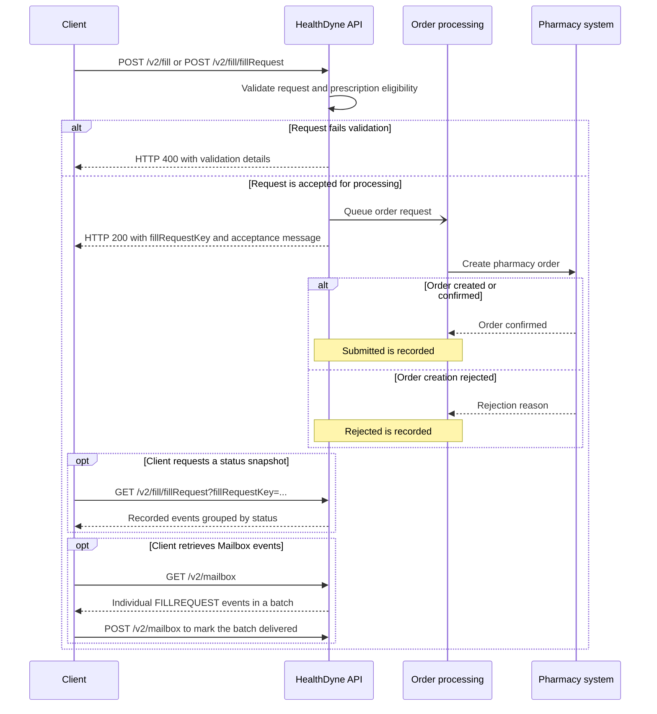
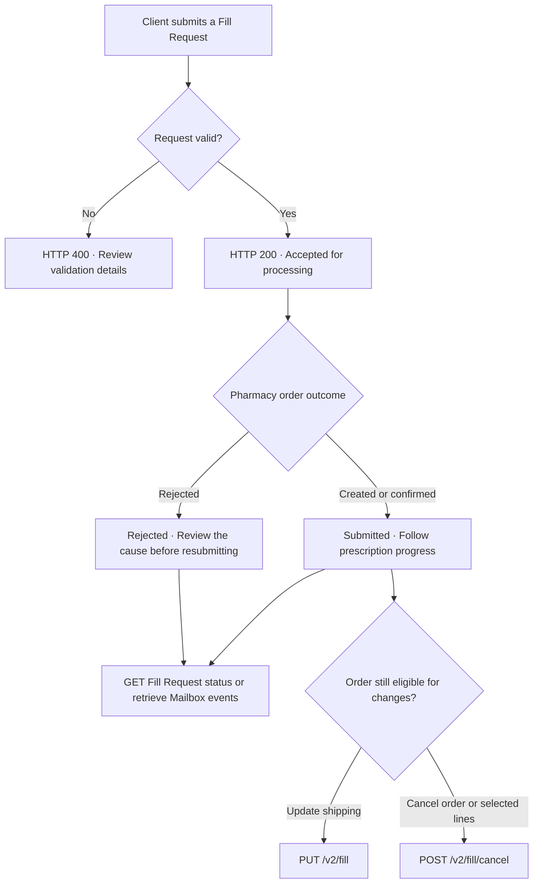

# Fill Request:

Use a Fill Request to initiate a HealthDyne pharmacy order for one or more prescriptions for the same patient. Check the Fill Request status endpoint or Mailbox for the downstream outcome. [Fill Request Data Object (Schemas)](doc:fill-request-fields)

# Get Fill Request Status

Look up a previously submitted Fill Request by its client-assigned `fillRequestKey`. The response groups events by type. Match prescription events using `scriptKey` and use the event timestamps to reconstruct the history. The `renewed` array contains recorded renewal events when available. [GET API reference](ref:get_v2-fill-fillrequest)

#### Server

##### Only HTTPS connections are accepted.

| METHOD TYPE | ENDPOINT                                                                    |
| :---------- | :-------------------------------------------------------------------------- |
| GET (Test)  | api.uat-healthdyne.com/v2/FILL/fillRequest?fillRequestKey=\<fillRequestKey> |
| GET (Prod)  | api.healthdyne.com/v2/FILL/fillRequest?fillRequestKey=\<fillRequestKey>     |

#### Header

| Key                         | Value                  |
| :-------------------------- | :--------------------- |
| Accept                      | application/json       |
| Content-Type                | application/json       |
| HealthDyne-Subscription-Key | Provided by HealthDyne |
| HealthDyne-Relationship-Key | Provided by HealthDyne for authorized vendor requests |

#### Sample GET Status Request

`GET https://api.uat-healthdyne.com/v2/fill/fillRequest?fillRequestKey=FILL-EXAMPLE-1001`

Click here to see [GET Fill Request Query Data](doc:fill-request-fields#query-parameter)

#### GET Status Response Samples

> 📘 NOTE: Sample for a Single-line Rx.

```json
{
  "fillRequestKey": "FILL-EXAMPLE-1000",
  "submitted": [
    {
      "eventId": "295955",
      "eventDateUtc": "2025-04-15T09:12:20.913021+00:00",
      "scriptKeys": [
        "SCRIPT-EXAMPLE-000"
      ]
    }
  ],
  "rxVerified": [
    {
      "eventId": "295965",
      "eventDateUtc": "2025-04-15T09:16:48.804578+00:00",
      "scriptKey": "SCRIPT-EXAMPLE-000",
      "verifiedDate": "2025-04-15T09:16:48.804578+00:00",
      "statusMessage": "The Rx has been verified by the pharmacist (PV1)"
    }
  ],
  "rxShipped": [
    {
      "eventId": "295985",
      "eventDateUtc": "2025-04-17T09:19:53.417176+00:00",
      "scriptKey": "SCRIPT-EXAMPLE-000",
      "shipmentDate": "2025-04-17T06:00:02Z",
      "trackingNumber": "7548253"
    }
  ],
  "rxIssue": [],
  "rxCanceled": [],
  "rejected": [],
  "renewed": []
}
```

> 📘 NOTE: Sample for a Multiline Rx.

```json
{
  "fillRequestKey": "FILL-EXAMPLE-1001",
  "submitted": [
    {
      "eventId": "295955",
      "eventDateUtc": "2025-04-15T09:12:20.913021+00:00",
      "scriptKeys": [
        "SCRIPT-EXAMPLE-001",
        "SCRIPT-EXAMPLE-002"
      ]
    }
  ],
  "rxVerified": [
    {
      "eventId": "288774",
      "eventDateUtc": "2025-04-15T09:16:48.804578+00:00",
      "scriptKey": "SCRIPT-EXAMPLE-001",
      "verifiedDate": "2025-04-15T09:16:48.804578+00:00",
      "statusMessage": "The Rx has been verified by the pharmacist (PV1)"
    },
    {
      "eventId": "2887749",
      "eventDateUtc": "2025-04-15T09:16:48.804578+00:00",
      "scriptKey": "SCRIPT-EXAMPLE-002",
      "verifiedDate": "2025-04-15T09:16:48.804578+00:00",
      "statusMessage": "The Rx has been verified by the pharmacist (PV1)"
    }
  ],
  "rxShipped": [],
  "rxIssue": [
    {
      "eventId": "289773",
      "eventDateUtc": "2025-04-15T09:30:57.585214+00:00",
      "scriptKey": "SCRIPT-EXAMPLE-001",
      "issueMessage": "REJECTED 533 HEALTHDYNE RX REJECTED - "
    }
  ],
  "rxCanceled": [
    {
      "eventId": "288784",
      "eventDateUtc": "2025-04-15T09:50:00Z",
      "scriptKey": "SCRIPT-EXAMPLE-001",
      "statusMessage": "Cancelled"
    },
    {
      "eventId": "2887864",
      "eventDateUtc": "2025-04-15T09:50:00Z",
      "scriptKey": "SCRIPT-EXAMPLE-002",
      "statusMessage": "Cancelled"
    }
  ],
  "rejected": [],
  "renewed": []
}
```

Click here to see [Get Fill Request Data Object](doc:fill-request-fields#response-object)

The table below lists the potential response codes that can be received in response to a GET request.

| Code | Description                                              |
| :--- | :------------------------------------------------------- |
| 200  | Fill Request status or a problem details response with `detail` set to `No record(s) found` |
| 400  | Missing or invalid request parameter        |
| 401  | Unauthorized                                             |
| 500  | Internal Server Error                                    |

***

# Submit Fill Request

Use a new `fillRequestKey` of up to 50 characters for each new request. Supply one or more unique prescription keys for the same patient. A transfer must be in `Transferred` status. Eligible prescriptions from HealthDyne intake can be in `Received` status. Discontinued prescriptions, prescriptions with no fills available, and keys outside the authorized client scope can fail validation. Replace sample values with valid values for the target environment. [Fill Request schemas](doc:fill-request-fields)

#### Fill Request Sequence



#### Fill Request API Flow

Use the flow to distinguish request acceptance from the pharmacy order outcome and see when shipping updates and cancellation apply.



#### Server

##### Only HTTPS connections are accepted.

| METHOD TYPE | ENDPOINT                       |
| :---------- | :----------------------------- |
| POST (Test) | api.uat-healthdyne.com/v2/fill |
| POST (Prod) | api.healthdyne.com/v2/fill     |
| POST (Test) | api.uat-healthdyne.com/v2/fill/fillrequest |
| POST (Prod) | api.healthdyne.com/v2/fill/fillrequest |

#### Header

| Key                         | Value                  |
| :-------------------------- | :--------------------- |
| Accept                      | application/json       |
| Content-Type                | application/json       |
| HealthDyne-Subscription-Key | Provided by HealthDyne |
| HealthDyne-Relationship-Key | Provided by HealthDyne for authorized vendor requests |

#### Standard Fill Request

`POST https://api.uat-healthdyne.com/v2/fill`

Send `scriptKeys` as an array of strings. Supply `shipping` and optional order-level `insurance`. When insurance is present, include `coPay` and `transactionNumber` inside it. For inline primary insurance use BIN, PCN, group number, member ID, and a relationship code. [Standard request](doc:fill-request-fields#request-object) · [Insurance fields](doc:fill-request-fields#insurance-data-object) · [POST API reference](ref:post_v2-fill)

```json
{
  "fillRequestKey": "FILL-EXAMPLE-1001",
  "scriptKeys": [
    "SCRIPT-EXAMPLE-001",
    "SCRIPT-EXAMPLE-002"
  ],
  "shipping": {
    "address": {
      "line1": "100 Example Street",
      "city": "LAKELAND",
      "state": "FL",
      "zipCode": "33810",
      "countryCode": "US"
    },
    "shippingCode": "POS 1M",
    "saturdayDelivery": false,
    "signatureRequired": false
  }
}
```

#### Sample Submit Fill Request (multiple insurances per fill request)

`POST https://api.uat-healthdyne.com/v2/fill/fillrequest`

Send `scriptsKeys` as an array of objects with `scriptsKey` on each object. Omit `patientInsurance` or send `null` for applicable default plan handling. Use top-level `transactionNumber` for the client transaction reference. If supplied, `paymentCardSequenceNumber` must be a digits-only string for a card already on the patient profile.

| Coverage level | Flat field | Nested field |
| :--- | :--- | :--- |
| Primary | `planNumber` | `primaryInsurance.planNumber` |
| Secondary | `secondaryPlanNumber` | `secondaryInsurance.secondaryPlanNumber` |
| Tertiary | `tertiaryPlanNumber` | `tertiaryInsurance.tertiaryPlanNumber` |

Include primary coverage whenever insurance is supplied. Tertiary requires primary and secondary. Use distinct plans, and supply matching plan numbers if you send both flat and nested fields for the same level. Inline details require BIN, group number, member ID, and relationship. PCN is optional for this route. When insurance is supplied, send `clientItemCost`, `clientDispenseFee`, `clientOtherFee`, `clientCoPay` as JSON numbers. The numeric representation of `clientCoPay` has an eight-character maximum. [Patient insurance fields](doc:fill-request-fields#patientinsurance-data-object) · [POST API reference](ref:post_v2-fill-fillrequest)

#### Optional OTC Items

Use top-level `otcItems` to include eligible products with at least one prescription. Each item requires a client-mapped `productId` of up to 20 characters and a positive integer `quantity`. Invalid items return HTTP 400. [OTC item fields](doc:fill-request-fields#otc-item-data-object)

#### Sample Submit Fill Request Body

> 📘 NOTE: This request allows to pass one insurance object per script  in the fill request

```json
{
  "fillRequestKey": "FILL-EXAMPLE-1002",
  "paymentCardSequenceNumber": "12345",
  "scriptsKeys": [
    {
      "scriptsKey": "SCRIPT-EXAMPLE-003",
      "patientInsurance": {
        "primaryInsurance": {
          "bin": "123456",
          "groupNumber": "EXAMPLEGRP",
          "memberId": "EXAMPLE001",
          "relationship": "1"
        },
        "secondaryPlanNumber": "502",
        "clientItemCost": 12.5,
        "clientDispenseFee": 2.25,
        "clientOtherFee": 0,
        "clientCoPay": 4
      }
    },
    {
      "scriptsKey": "SCRIPT-EXAMPLE-004",
      "patientInsurance": {
        "planNumber": "501",
        "clientItemCost": 13.5,
        "clientDispenseFee": 2.25,
        "clientOtherFee": 0,
        "clientCoPay": 5
      }
    }
  ],
  "shipping": {
    "address": {
      "line1": "100 Example Street",
      "city": "LAKELAND",
      "state": "FL",
      "zipCode": "33810",
      "countryCode": "US"
    },
    "shippingCode": "POS 1M",
    "saturdayDelivery": false,
    "signatureRequired": false
  },
  "transactionNumber": "TXN-EXAMPLE-1002",
  "otcItems": [
    {
      "productId": "00000000001",
      "quantity": 2
    }
  ]
}
```

Click here to see [Per-prescription request](doc:fill-request-fields#request-object-1)

#### Sample Submit Fill Response

```json
{
  "fillRequestKey": "FILL-EXAMPLE-1002",
  "message": "The fill request was accepted"
}
```

Click here to see [Standard submit response](doc:fill-request-fields#response-object-1) · [Per-prescription submit response](doc:fill-request-fields#response-object-2)

HTTP 200 acknowledges receipt for processing. Use `Submitted` or `Rejected` to determine the order outcome. Read `validationErrors` or problem details on a failed request. A duplicate key returns HTTP 400. If the original result is uncertain, look up the existing key before submitting another request.

For submit and update, use a supported shipping code and include line 1, city, a two-letter state, and a five-digit ZIP or ZIP+4. Set Saturday delivery only for a service that supports it. [Address](doc:fill-request-fields#address-data-object) · [Shipping codes](doc:fill-request-fields#shipping-codes)

***

# Update Fill Request

Send the existing `fillRequestKey` and the address and shipping code in `shipping`. The update applies to the order. Pharmacy locks and fulfillment status can prevent changes. [PUT API reference](ref:put_v2-fill)

#### Server

##### Only HTTPS connections are accepted.

| METHOD TYPE | ENDPOINT                       |
| :---------- | :----------------------------- |
| PUT (Test)  | api.uat-healthdyne.com/v2/fill |
| PUT (Prod)  | api.healthdyne.com/v2/fill     |

#### Sample Update Fill Request

`PUT https://api.uat-healthdyne.com/v2/fill`

#### Sample Update Fill Request Body

```json
{
  "fillRequestKey": "FILL-EXAMPLE-1002",
  "shipping": {
    "address": {
      "line1": "UpdateAgain1",
      "line2": null,
      "line3": null,
      "city": "LAKELAND",
      "state": "FL",
      "zipCode": "33810",
      "countryCode": "US"
    },
    "shippingCode": "POS 1C",
    "saturdayDelivery": false,
    "signatureRequired": false
  }
}
```

Click here to see [Update Fill Request Data Object](doc:fill-request-fields#request-object-2)

#### Sample Update Fill Response

```json
{
  "fillRequestKey": "FILL-EXAMPLE-1002",
  "message": "The fill update request was accepted"
}
```

Click here to see [Update Fill Response Data Object](doc:fill-request-fields#response-object-3)

<br />

***

# Cancel Fill Request

Supply the existing `fillRequestKey` and a `cancelReason` of up to 255 characters. Supply associated `scriptKeys` for a line cancellation. Omit the array or send `[]` to request cancellation of the whole order while it remains eligible. [Cancel API reference](ref:post_v2-fill-cancel)

#### Server

###### Only HTTPS connections are accepted.

| METHOD TYPE | ENDPOINT                              |
| :---------- | :------------------------------------ |
| POST (Test) | api.uat-healthdyne.com/v2/fill/cancel |
| POST (Prod) | api.healthdyne.com/v2/fill/cancel     |

#### Sample Cancel Fill Request

`POST https://api.uat-healthdyne.com/v2/fill/cancel`

#### Sample Cancel Fill Request Body

```json
{
  "fillRequestKey": "FILL-EXAMPLE-1002",
  "scriptKeys": [
    "SCRIPT-EXAMPLE-004"
  ],
  "cancelReason": "Cancelled"
}
```

Click here to see [Cancel Fill Request Data Object](doc:fill-request-fields#request-object-3)

#### Sample Cancel Fill Request Response

```json
{
  "fillRequestKey": "FILL-EXAMPLE-1002",
  "message": "Prescription fill for [SCRIPT-EXAMPLE-004] under Fill request [FILL-EXAMPLE-1002] has been canceled."
}
```

Click here to see [Cancel Response Data Object](doc:fill-request-fields#response-object-4)

# Fill Request Status Mailbox Events

Mailbox returns individual `FILLREQUEST` messages. Correlate by `fillRequestKey` and by `detail.scriptKey` when present. Order-level messages can contain comma-separated prescription keys. Use Mailbox for copay and payment events. [Fill Request status events](doc:mail-box#fill-request-status-events)

# Submitted Status

HealthDyne will create the order after receiving a Fill Request by sending create order command in the downstream pharmacy management system. Once the order has been successfully created, HealthDyne will generate a ‘submitted’ order status message and queues the event up for the client to retrieve it. See [Fill Request Submitted Status Event](doc:mail-box#submitted).

# Rejected Status

If order creation errors/rejects; then Rejected event will be created. Possible reasons for system to reject order request include existing open orders for an Rx. See [Fill Request Rejected Status Event](doc:mail-box#rejected)

# RxVerified

A "RxVerified" event will be generated once a Pharmacist has completed PV1 and released the prescription for fulfillment. See [Fill Request RxVerified Status Event](doc:mail-box#rxverified).

# RxShipped

Once the Rx has been shipped successfully by pharmacy, then send update for each Rx within the order will be sent to client. This event will be ‘Shipped’ event sent for each Rx. See [Fill Request Shipped Status Event](doc:mail-box#shipped)

# RxIssue

When an Order is successfully created, and then one of the Rx is subsequently rejected by pharmacy because there is an issue with the prescription (reason such as: Insurance reason/DUR/Pharmacy unable to read the prescription)- then RxIssue event will be pushed only for the prescription having an issue. See [Fill Request RxIssue Event Status](doc:mail-box#rxissue)

# RxCancel

The Mailbox status value is `RxCanceled`.

When a Rx or multiple Rx(s) in the order have been canceled pharmacy, HealthDyne will send an update at Rx level for each Rx in the order notifying of the canceled status. By default, unless order split has been configured for the client, the entire order will be canceled when there is an issue with any of the Rx in the same order. Cancelled Rx that have not also been rejected due to "RxIssue" are available to be assigned to a new Fill Request without additional action via the Script API. See [Fill Request RxCancel Status Event](doc:mail-box#rxcancel).

# RxCopay

Adjudication completed and copay and insurance details are available. [RxCopay](doc:mail-box#rxcopay)

# RxPaymentDeclined

The payment attempt failed. [RxPaymentDeclined](doc:mail-box#rxpaymentdeclined)

# RxPaymentRequired

Payment is required before shipment. [RxPaymentRequired](doc:mail-box#rxpaymentrequired)