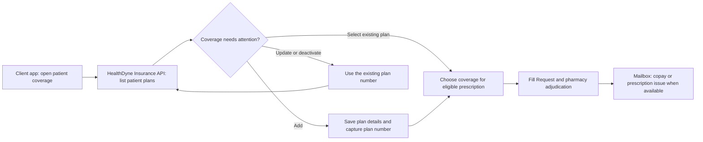

# Insurance Plan Request:

See the [Insurance](ref:get_v2-patient-insurance) API reference for request message fields.

This API lets clients define and update insurance information in the HealthDyne system.

Use POST method to add/create an insurance plan and assign to an existing patientKey. Use the GET method to retrieve insurance plan information for a patient. The DELETE method can be used to set an insurance plan to inactive for a patient.

## How insurance on the patient profile is used

Use Insurance to maintain the plans associated with an existing HealthDyne patient. The client app can list plans when staff review coverage, record a new plan, and keep the plan number for later selection in a Fill Request where the endpoint supports it. Pharmacy adjudication determines the outcome for an individual prescription.



| What you need to do | Which information to use |
| :--- | :--- |
| Review coverage | Open the patient profile and list its plans. Confirm which plan is primary and which is secondary before placing an order. |
| Add coverage to a patient profile | Enter the payer and member details. Supply BIN when you provide PCN or Group ID. Save the returned plan number for later use. Follow the [patient insurance schema](doc:insurance-request-fields#create-insurance-data-object) for profile fields. |
| Correct or deactivate an existing plan | Use the patient key and the plan number. Refresh the plan list after the update so staff can see which options are available. |
| Choose coverage for individual prescriptions | Use the per-prescription Fill Request when prescriptions need different plans. Tertiary coverage requires distinct primary and secondary plans. For detailed inline insurance on that route, Group Number is required and PCN can be omitted. |
| Check the pharmacy's result | Look for [RxCopay](doc:mail-box#rxcopay) for the adjudicated copay or [RxIssue](doc:mail-box#rxissue) for a problem that needs follow-up. Match the event to the affected prescription. |

[Insurance schema](doc:insurance-request-fields) · [Insurance API reference](ref:get_v2-patient-insurance) · [Per-prescription insurance in Fill Request](doc:fill-request-fields#patientinsurance-data-object)

### Server

##### Only https connections are accepted.

| REQUEST TYPE                | ENDPOINT                                    |
| :-------------------------- | :------------------------------------------ |
| GET, POST, PUT, or DELETE (Test) | api.uat-healthdyne.com/v2/patient/insurance |
| GET, POST, PUT, or DELETE (Prod) | api.healthdyne.com/v2/patient/insurance     |

### Header

| Key                         | Value                  |
| :-------------------------- | :--------------------- |
| Accept                      | application/json       |
| Content-Type                | application/json       |
| HealthDyne-Subscription-Key | Provided by HealthDyne |

### Sample Insurance Plan GET Request

`Get:https://api.uat-healthdyne.com/v2/patient/insurance?patientKey=ds76sa5765sad`

### Sample Get Insurance Plan Response

```json
{
  "patientKey": "ds76sa5765sad",
  "insurance":[
    {
      "planNumber":"209235",
      "bin": "123456",
      "groupId": "123456789",
      "pcn": "15948546",
      "personCode": "001",
      "relationshipCode": "1",
      "insuranceMemberID": "23456"
    },
    {
      "planNumber": "162311",
      "bin": "",
      "groupId": "ABCD123",
      "pcn": "",
      "personCode": "001",
      "relationshipCode": "1",
      "insuranceMemberID": null
    }
  ]
}
```

Click here to see [Get Insurance Data Object](doc:insurance-request-fields#get-insurance-data-object)

# POST / Create

### Sample Insurance Plan POST Request

```json
{
  "patientKey": "ds76sa5765sad",
  "insurance": {
    "policyHolderId": "68945143",
    "bin": "123456", 
    "groupId": "123456789",
    "pcn": "15948546",
    "personCode": "1",
    "relationshipCode": "1",
    "insuranceMemberID": "67844"
  }
}
```

### Sample ADD Insurance Plan Response Message

```json
{
  "patientKey": "ds76sa5765sad",
  "planNumber": "209235",
  "message": "Plan added to patient profile."
}
```

Click here to see [Create Insurance Data Object](doc:insurance-request-fields#create-insurance-data-object)

# PUT/ Update

### Sample Insurance Plan PUT Request

```json
{
    "patientKey": "ds76sa5765sad",
    "insurance": {
        "planNumber": "123456789",
        "personCode": "1",
        "relationshipCode": "1",
        "insuranceMemberID": "67844"
    }
}
```

### Sample PUT Insurance Plan Response Message

```json
{
  "patientKey": "ds76sa5765sad",
  "planNumber": "209235",
  "message": "Plan updated in patient profile."
}
```

Click here to see [Update Insurance Data Object](doc:insurance-request-fields#update-insurance-data-object)

# DELETE

### Sample DELETE Insurance Plan Request

`Delete:https://api.uat-healthdyne.com/v2/patient/insurance?patientKey=ds76sa5765sad&planNumber=209235`

### Successful DELETE Insurance Plan Response Message

```json
{
  "patientKey": "ds76sa5765sad",
  "planNumber": "209235",
  "message": "Patient Insurance plan number is inactivated successfully"
}
```

Click here to see [Delete Insurance Data Object](doc:insurance-request-fields#delete-insurance-data-object)