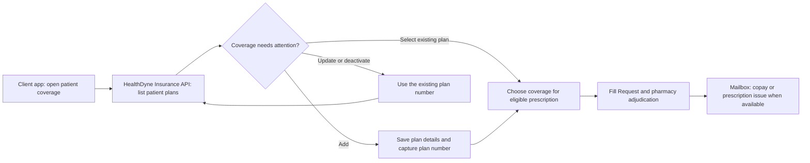

# Insurance Plan Request:

See the [Insurance](ref:get_v2-patient-insurance) API reference for request message fields.

This API lets clients define and update insurance information in the HealthDyne system.

Use POST method to add/create an insurance plan and assign to an existing patientKey. Use the GET method to retrieve insurance plan information for a patient. The DELETE method can be used to set an insurance plan to inactive for a patient.

## How insurance on the patient profile is used

Use Insurance to maintain the plans associated with an existing HealthDyne patient. The client app can list plans when staff review coverage, record a new plan, and keep the plan number for later selection in a Fill Request where the endpoint supports it. Pharmacy adjudication determines the outcome for an individual prescription.



| Task | Why it matters | What to retain |
| :--- | :--- | :--- |
| List patient plans | Lets staff review the patient's available coverage before order entry. | The patient key and the plan numbers returned for selection. |
| Add a plan | Associates payer and member details with the patient for reuse. | The plan number returned on success. Supply BIN when PCN or Group ID is provided. |
| Update a plan | Corrects supported details for a selected plan. | Use the existing plan number under the same patient. |
| Deactivate a plan | Removes outdated coverage from future selection. | Use the right patient and plan number, then refresh the plan list. |

### Common scenarios

<Accordion title="A patient has primary and secondary coverage">
  Review the patient's existing plans and confirm their priority before placing the order. Use the per-prescription Fill Request route if different prescriptions need different plans. Tertiary coverage requires both primary and secondary, and the plan numbers must be distinct.
</Accordion>

<Accordion title="The insurance card has no PCN">
  Use the rules for the endpoint you are calling. The per-prescription Fill Request route allows PCN to be omitted for inline insurance while Group Number remains required in that detailed request. Use the [patient insurance schema](doc:insurance-request-fields#create-insurance-data-object) when creating an insurance record on the profile.
</Accordion>

<Accordion title="Staff need to know whether a prescription was covered">
  After the fill is submitted, review Mailbox for [RxCopay](doc:mail-box#rxcopay) or an [RxIssue](doc:mail-box#rxissue) for the affected prescription. Keep the plan information available to support follow-up.
</Accordion>

[Insurance schema](doc:insurance-request-fields) · [Insurance API reference](ref:get_v2-patient-insurance) · [Per-prescription insurance in Fill Request](doc:fill-request-fields#patientinsurance-data-object)

### Server

##### Only https connections are accepted.

| REQUEST TYPE                | ENDPOINT                                    |
| :-------------------------- | :------------------------------------------ |
| GET, POST, PUT, or DELETE (Test) | api.uat-healthdyne.com/v2/patient/insurance |
| GET, POST, PUT, or DELETE (Prod) | api.healthdyne.com/v2/patient/insurance     |

### Header

| Key                         | Value                  |
| :-------------------------- | :--------------------- |
| Accept                      | application/json       |
| Content-Type                | application/json       |
| HealthDyne-Subscription-Key | Provided by HealthDyne |

### Sample Insurance Plan GET Request

`Get:https://api.uat-healthdyne.com/v2/patient/insurance?patientKey=ds76sa5765sad`

### Sample Get Insurance Plan Response

```json
{
  "patientKey": "ds76sa5765sad",
  "insurance":[
    {
      "planNumber":"209235",
      "bin": "123456",
      "groupId": "123456789",
      "pcn": "15948546",
      "personCode": "001",
      "relationshipCode": "1",
      "insuranceMemberID": "23456"
    },
    {
      "planNumber": "162311",
      "bin": "",
      "groupId": "ABCD123",
      "pcn": "",
      "personCode": "001",
      "relationshipCode": "1",
      "insuranceMemberID": null
    }
  ]
}
```

Click here to see [Get Insurance Data Object](doc:insurance-request-fields#get-insurance-data-object)

# POST / Create

### Sample Insurance Plan POST Request

```json
{
  "patientKey": "ds76sa5765sad",
  "insurance": {
    "policyHolderId": "68945143",
    "bin": "123456", 
    "groupId": "123456789",
    "pcn": "15948546",
    "personCode": "1",
    "relationshipCode": "1",
    "insuranceMemberID": "67844"
  }
}
```

### Sample ADD Insurance Plan Response Message

```json
{
  "patientKey": "ds76sa5765sad",
  "planNumber": "209235",
  "message": "Plan added to patient profile."
}
```

Click here to see [Create Insurance Data Object](doc:insurance-request-fields#create-insurance-data-object)

# PUT/ Update

### Sample Insurance Plan PUT Request

```json
{
    "patientKey": "ds76sa5765sad",
    "insurance": {
        "planNumber": "123456789",
        "personCode": "1",
        "relationshipCode": "1",
        "insuranceMemberID": "67844"
    }
}
```

### Sample PUT Insurance Plan Response Message

```json
{
  "patientKey": "ds76sa5765sad",
  "planNumber": "209235",
  "message": "Plan updated in patient profile."
}
```

Click here to see [Update Insurance Data Object](doc:insurance-request-fields#udpate-insurance-data-object)

# DELETE

### Sample DELETE Insurance Plan Request

`Delete:https://api.uat-healthdyne.com/v2/patient/insurance?patientKey=ds76sa5765sad&planNumber=209235`

### Successful DELETE Insurance Plan Response Message

```json
{
  "patientKey": "ds76sa5765sad",
  "planNumber": "209235",
  "message": "Patient Insurance plan number is inactivated successfully"
}
```

Click here to see [Delete Insurance Data Object](doc:insurance-request-fields#delete-insurance-data-object)