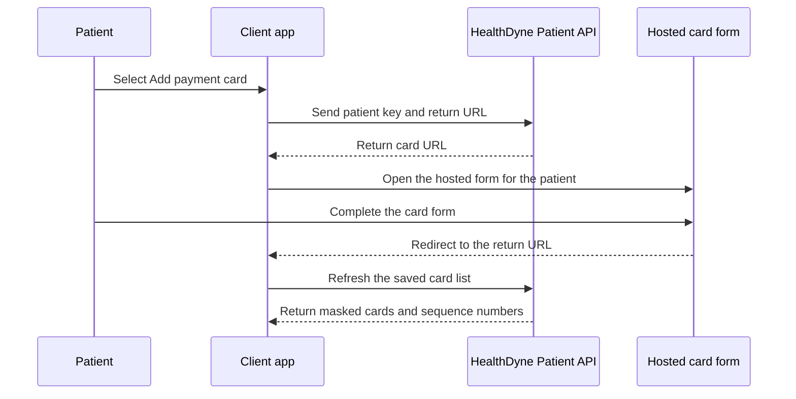

# Payment Card Request:

See the [Payment Card field definitions](doc:patient-request-fields#patient-payment-cards-objects) for request message fields.

This API lets clients add and update patient payment cards information in the HealthDyne system. A client can also use the GET method of patient payment request to retrieve patient payment card information.

Use POST method to add a payment card to the patient profile  and PUT method to update existing patient payment card details.

## How a patient saves and uses a payment card

Use Payment Cards to add or manage a card on a HealthDyne patient profile. When adding a card, the client app starts the request and sends the patient to HealthDyne's hosted card form. For order checkout, the app references a saved card using its sequence number.



| What the patient wants to do | What the app does |
| :--- | :--- |
| Add a card | Request the hosted form using the patient key and a complete return URL such as `https://example.com/checkout`. Open the returned form. When the patient returns, reload the active card list to confirm the card was saved before offering it at checkout. |
| Pay with a saved card | Show masked card details. For a per-prescription Fill Request, send the selected card's sequence number as the digits-only string `paymentCardSequenceNumber`. Use a card belonging to that patient. Check [Mailbox payment events](doc:mail-box#rxpaymentrequired) for the payment outcome. |
| Update the name or expiration | Send the patient key, card sequence number, and the supported details that changed. Show the updated card after the request succeeds. |
| Replace a card or stop using it | Open the hosted form to add a different card number. Deactivate the previous card when it should no longer be offered, then refresh the list. |

[Payment card field definitions](doc:patient-request-fields#patient-payment-cards-objects) · [Fill Request](doc:fill-request)

# Get Patient Payment card

Once a patient payment card has been registered successfully, the GET Patient Payment Card API allows clients to retrieve Payment Card details (active details) from HD pharmacy system using PatientKey.

### Server

##### Only HTTPS connections are accepted.

| METHOD TYPE | ENDPOINT                                                    |
| :---------- | :---------------------------------------------------------- |
| GET (Test)  | api.uat-healthdyne.com/v2/patient/\<patientKey>/paymentcard |
| GET (Prod)  | api.healthdyne.com/v2/patient/\<patientKey>/paymentcard     |

### Header

| Key                         | Value                       |
| :-------------------------- | :-------------------------- |
| Accept                      | application/json (optional) |
| HealthDyne-Subscription-Key | Provided by HealthDyne      |

#### Sample GET Patient Request

`GET https://api.uat-healthdyne.com/v2/patient/TestreadPatient171/paymentcard`

#### Sample GET Patient Payment Card Response

```json
{
  "patientKey": "TestreadPatient171",
  "cards": [
    {
      "cardType": 1,
      "cardNumber": "*********************1111",
      "cardHolderFirstName": "Test",
      "cardHolderLastName": "Partient",
      "cardExpireMonth": 3,
      "cardExpireYear": 2027,
      "defaultCard": true,
      "cardSequenceNumber": "415129",
      "cardStatus": "Active"
    }
  ]
}
```

Click here to see [Get Patient Payment Card Response Data Object](doc:patient-request-fields#get-patient-payment-cards-request)

The below table lists the potential response codes that can be received in response to a GET request.

| Code | Description                            |
| :--- | :------------------------------------- |
| 200  | Patient Payment Cards details returned |
| 204  | No record returned for search          |
| 401  | Unauthorized                           |
| 500  | Internal Server Error                  |

<br />

# Add Patient Payment card

The POST Patient Payment Card API allows clients to add Payment Card details to HD pharmacy system.

### Server

##### Only HTTPS connections are accepted.

| METHOD TYPE | ENDPOINT                                      |
| :---------- | :-------------------------------------------- |
| POST (Test) | api.uat-healthdyne.com/v2/patient/paymentcard |
| POST (Prod) | api.healthdyne.com/v2/patient/paymentcard     |

### Header

| Key                         | Value                  |
| :-------------------------- | :--------------------- |
| Accept                      | application/json       |
| Content-Type                | application/json       |
| HealthDyne-Subscription-Key | Provided by HealthDyne |

#### Sample POST Patient Payment Card Request

```json
{
    "patientKey": "TestreadPatient171",
    "returnUrl" : "https://www.callbackurl.com"
}
```

Click here to see [Add Patient Payment Card Request Data Object](doc:patient-request-fields#add-patient-payment-cards-request)

#### Sample POST Patient Payment Card Response

```json
{
    "cardUrl": "https://cardcenter.qa-healthdyne.com/AddCard/c440977f-dba1-4d5f-aa5f-2862cd81"
}
```

Click here to see [Add Patient Payment Card Response Data Object](doc:patient-request-fields#add-patient-payment-cards-request)

The below table lists the potential response codes that can be received in response to a GET request.

| Code | Description                               |
| :--- | :---------------------------------------- |
| 200  | Patient Payment Cards details returned    |
| 400  | Patient Key provided does not exist in HD |
| 401  | Unauthorized                              |
| 500  | Internal Server Error                     |

<br />

# Update Patient Payment card

Once a patient payment card has been registered successfully, the PUT Patient Payment Card API allows clients to update Payment Card details (active details) in HD pharmacy system.

### Server

##### Only HTTPS connections are accepted.

| METHOD TYPE | ENDPOINT                                      |
| :---------- | :-------------------------------------------- |
| PUT (Test)  | api.uat-healthdyne.com/v2/patient/paymentcard |
| PUT (Prod)  | api.healthdyne.com/v2/patient/paymentcard     |

### Header

| Key                         | Value                  |
| :-------------------------- | :--------------------- |
| Accept                      | application/json       |
| Content-Type                | application/json       |
| HealthDyne-Subscription-Key | Provided by HealthDyne |

#### Sample PUT Patient Payment Card Request

```json
{
  "patientKey": "TestreadPatient171",
  "cardSequenceNumber": "1234567891111",
  "expirationMonth": 3,
  "expirationYear": 2028,
  "cardFirstName": "test",
  "cardMiddleName": "u",
  "cardLastName": "patient"
}
```

Click here to see [Update Patient Payment Card Request Data Object](doc:patient-request-fields#update-patient-payment-cards-request)

#### Sample Put Patient Payment Card Response

```json
{
  "patientKey": "TestreadPatient171",
  "cardSequenceNumber": "1234567891111",
  "message" : "Payment card updated successfully."
}
```

Click here to see [Update Patient Payment Card Response Data Object](doc:patient-request-fields#update-patient-payment-cards-request)

The below table lists the potential response codes that can be received in response to a POST request.

| Code | Description                            |
| :--- | :------------------------------------- |
| 200  | Patient Payment Cards details returned |
| 400  | No record returned for search          |
| 401  | Unauthorized                           |
| 500  | Internal Server Error                  |

# Deactivate Patient Payment card

The DELETE Patient Payment Card API allows clients to deactivate a Payment Card in HD pharmacy system.

### Server

##### Only HTTPS connections are accepted.

| METHOD TYPE   | ENDPOINT                                      |
| :------------ | :-------------------------------------------- |
| DELETE (Test) | api.uat-healthdyne.com/v2/patient/paymentcard |
| DELETE (Prod) | api.healthdyne.com/v2/patient/paymentcard     |

### Header

| Key                         | Value                  |
| :-------------------------- | :--------------------- |
| Accept                      | application/json       |
| Content-Type                | application/json       |
| HealthDyne-Subscription-Key | Provided by HealthDyne |

#### Sample DELETE Patient Payment Card Request

```json
{
    "patientKey": "TestreadPatient171",
    "cardSequenceNumber": "1234567891111"
}
```

Click here to see [Deactivate Patient Payment Card Request Data Object](doc:patient-request-fields#deactivate-patient-payment-cards-request)

#### Sample DELETE Patient Payment Card Response

```json
{
    "patientKey": "DTCUserM101",
    "cardSequenceNumber": "415051",
    "message": "Deactivated"
}
```

Click here to see [Deactivate Patient Payment Card Response Data Object](doc:patient-request-fields#deactivate-patient-payment-cards-request)

The below table lists the potential response codes that can be received in response to a DELETE request.

| Code | Description                            |
| :--- | :------------------------------------- |
| 200  | Patient Payment Cards details returned |
| 400  | No record returned for search          |
| 401  | Unauthorized                           |
| 500  | Internal Server Error                  |